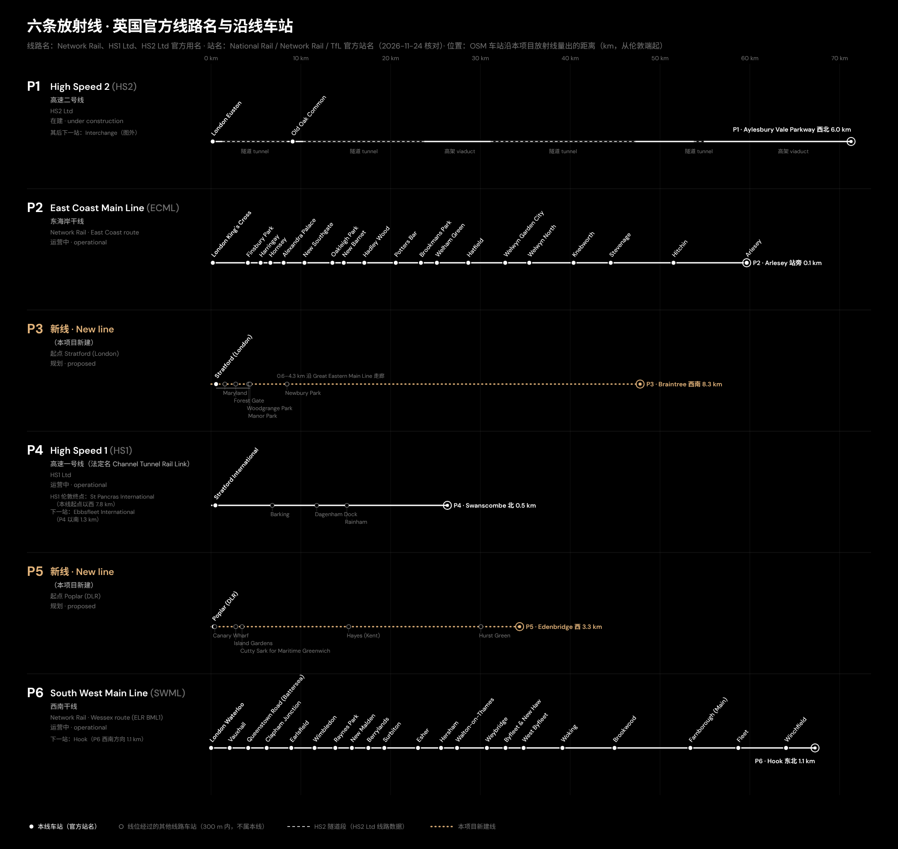

# 六条放射线 · 官方线路名与沿线车站 · The six radials: official line names and their stations

`radials-official.png`（`radials-official.svg` 同图）是 Loop City 第 1 步六条放射线的参考图，以后生成、标注相关内容都以它为准。

| 放射线 | 官方线路名 | 管理方 | 状态 | 伦敦端 | 本线车站（本项目线段内） |
|---|---|---|---|---|---|
| P1 | High Speed 2 (HS2) | HS2 Ltd | 在建 | London Euston | London Euston、Old Oak Common |
| P2 | East Coast Main Line (ECML) | Network Rail · East Coast route | 运营中 | London King's Cross | King's Cross → Arlesey，19 站 |
| P3 | 新线（本项目） | — | 规划 | Stratford (London) | 起点 Stratford (London)；0.6–4.3 km 沿 Great Eastern Main Line 走廊 |
| P4 | High Speed 1 (HS1)，法定名 Channel Tunnel Rail Link | HS1 Ltd | 运营中 | Stratford International | Stratford International；HS1 伦敦终点为 St Pancras International，下一站 Ebbsfleet International 在 P4 以南 1.3 km |
| P5 | 新线（本项目） | — | 规划 | Poplar (DLR) | 起点 Poplar（DLR 车站） |
| P6 | South West Main Line (SWML) | Network Rail · Wessex route（ELR BML1） | 运营中 | London Waterloo | London Waterloo → Winchfield，21 站；下一站 Hook 在 P6 西南方向 1.1 km |

## 规则 · Rules

- **线路名**用基础设施管理方（Network Rail、HS1 Ltd、HS2 Ltd）的官方英文名。中英文界面都以英文名为主，中文界面在下面加一行中文译名。
- **站名**用官方站名：国铁站按 National Rail / Network Rail 的写法，DLR 车站按 TfL 的写法，例如 Stratford (London)、Queenstown Road (Battersea)、Byfleet & New Haw、Harlington (Bedfordshire)、Hayes (Kent)、Poplar (DLR)。King's Cross 用车站所有者 Network Rail 的写法「London King's Cross」；National Rail Enquiries 写作「London Kings Cross (KGX)」。OSM 名与官方名不同的，对照表在 `radials.json` 的 `officialNames`。
- **本线车站**只算这条线停靠的车站。线位经过、但属于别的线路的车站（如 P1 下方 Central line 的各站：HS2 在它们地下的隧道里穿过）单独标出，不算本线车站。OSM 把一些伦敦地铁站标成了国铁（Euston Square、Caledonian Road、Lambeth North、Nine Elms 等），这里都已排除。

## 文件 · Files

- `radials.json`：线路、车站、来源链接（2026-11-24 核对）。改这里，再运行下面两个工具。
- `../tools/build-radials-reference.py`：按页面的 `HW_RAIL` 和 OSM 车站，把车站放到放射线上量出距离（每站必须在 300 m 以内，否则报错停下），画出 `radials-official.svg` 和 `.png`。
- `../tools/build-intro.py`：开场介绍的线路名、伦敦端站名、沿线车站和「最近国铁站」标签都从 `radials.json` 读。

The figure and `radials.json` are the reference for the six radials: the official name of each line (Network Rail, HS1 Ltd, HS2 Ltd) and the stations it serves within the radial, by their official names, with sources. Stations a radial passes on other lines are shown apart. `tools/build-radials-reference.py` draws the figure from the page's rail and the OSM stations; `tools/build-intro.py` takes its names from the same file.
